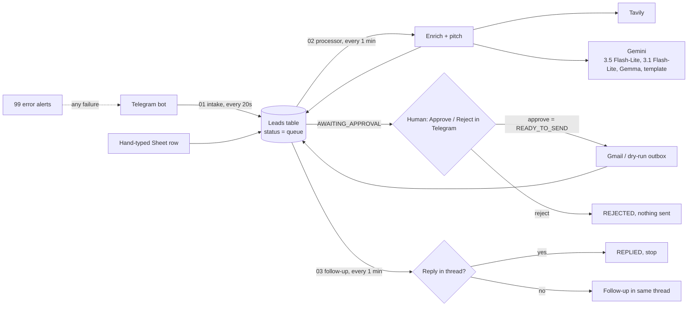

# GoPratle BDR Lead Enrichment & Outreach Agent

Type `Find event leads for Zomato in Gurgaon` in Telegram (or add a *Company + City* row to a Google Sheet).
The agent finds the Founder / HR / Events contact, finds their email, writes a tailored **3-line pitch** for
GoPratle, logs everything back to the Sheet, waits for **your approval** (Approve / Reject buttons in Telegram), then sends the outreach and schedules a
**follow-up in the same thread** that is cancelled automatically if the lead replies.

Built on **n8n** with a **free-tier-only** stack: Gemini (LLM), Tavily (search), Telegram, Google Sheets, Gmail.
Nothing is emailed without a human tap, and sandbox mode is on by default, so nothing can reach a real lead by accident.

```
Telegram ─┐                         ┌─> Gemini  (pick contact, write pitch)
          ├─> queue (Sheet) ─> n8n ─┼─> Tavily  (find company, people)
Sheet row ┘                         └─> Gmail   (send + follow-up in thread)
```

## The brief, point by point

| Requirement | How it is met |
|---|---|
| Trigger: Company + City in a Sheet **or** a Telegram command | Both feed the same queue: [workflow 01](workflows/01_telegram_intake.json) and hand-typed Sheet rows |
| Find the Founder / HR / Events lead online | Tavily search (LinkedIn result snippets + web) -> Gemini extracts candidates -> **every candidate is verified against the source text in code** and ranked by role and company size |
| Pull profile / contact info | LinkedIn URL from search results (no scraping, no login); email via Hunter, then the company site, then a verified-domain pattern guess |
| Tailored 3-line pitch for GoPratle | Gemini, with output validation (exactly 3 lines, no placeholders, mentions the company) and a deterministic fallback template |
| Log back into the Sheet | Leads tab (one row per lead) + Activity_log tab (every step) |
| Trigger / schedule outreach + follow-up | Gmail send, then workflow 03 sends the follow-up in the same thread, or marks `REPLIED` and stops |
| Sandbox / test accounts fine | Sandbox is the default and is enforced in code, not in the workflows |

## Architecture



Lead status flow: `NEW -> PROCESSING -> AWAITING_APPROVAL -> READY_TO_SEND -> SENT -> FOLLOWED_UP | REPLIED`, with side exits
`REJECTED`, `NEEDS_REVIEW`, `NOT_FOUND`, `DUPLICATE`, `FAILED`. Details: [docs/architecture.md](docs/architecture.md).

**Layout.** The logic lives in small, unit-tested modules in `src/` behind two swappable ports (storage and mail).
`scripts/build_workflows.py` generates the importable n8n workflows from them, so each workflow node is a thin call
into tested code and the JSON never drifts from the source.

```
src/
  lib.js        pure helpers: command parsing, role scoring, validators, anti-hallucination checks
  pipeline.js   enrichment: search -> people -> email -> pitch (Gemini model chain, search fallback)
  store.js      storage port:  LocalStore (JSON file) | SheetsStore (Google Sheets REST)
  mailer.js     mail port:     DryRunMailer (outbox)  | GmailMailer (Gmail REST) + sandbox enforcement
  telegram.js   Bot API helpers
  agent.js      orchestration used by every workflow node
workflows/      generated n8n JSON: 01 intake, 02 processor, 03 follow-up, 99 error alerts
sheet/          CSV templates for the Leads / Activity_log / Config tabs
scripts/        build_workflows.py, run_local.js, enrich_cli.js, init_sheet.js, sa_to_env.py, gmail_auth.js
tests/          81 tests, no network
docs/           architecture, setup, Google setup, failure modes, decisions, test report, demo script
```

## Quickstart (about 5 minutes, no Google account needed)

```bash
cp .env.example .env          # then fill in the keys below
make up                       # n8n at http://localhost:5678
make import                   # loads the 4 workflows
make test                     # 81 tests
```

Free keys needed: **Gemini** (aistudio.google.com/apikey), **Tavily** (tavily.com), a **Telegram bot** (@BotFather) and your chat id.
Step-by-step, including where each value goes: [docs/setup.md](docs/setup.md).

With the defaults (`STORE_BACKEND=local`, `MAIL_BACKEND=dryrun`) everything runs for real except Google: leads are stored in
a local file and emails are written to an outbox and previewed in Telegram. When you are ready for Google, follow
[docs/setup-google.md](docs/setup-google.md) and switch to `STORE_BACKEND=sheets`, `MAIL_BACKEND=gmail`.

Try it without n8n:

```bash
node scripts/enrich_cli.js "Zomato" "Gurgaon"     # live enrichment only, sends nothing
node scripts/run_local.js add "Swiggy" "Bengaluru" && node scripts/run_local.js tick
```

## Safety and reliability (the parts worth discussing)

* **Human approval before every send.** A finished draft stops at `AWAITING_APPROVAL` and Telegram shows the card with **Approve & send / Reject** buttons (or type `approve LD-0005`). Only allow-listed chats can decide; the setting fails closed (`REQUIRE_APPROVAL`). Approving the first email also covers its follow-up.
* **Hard send lock.** `SEND_ALLOWLIST` lists the only addresses that may receive mail; the Gmail backend refuses to send at all while it is empty.
* **Sandbox is enforced in the mailer.** Real recipients are emailed only if `SANDBOX_MODE=false` **and** `ALLOW_REAL_SEND=true`. A placeholder sandbox address is refused.
* **No invented contacts.** A person is accepted only if their name literally appears in the fetched search text and the cited source URL is one we fetched. Guessed emails are labelled `guessed` and capped at 0.7 confidence.
* **LLM output is never trusted.** Strict JSON, validated; one retry; then a deterministic template pitch. Web text is passed to the model as marked data.
* **Quota-aware.** Gemini chain: 3.5 Flash-Lite -> 3.1 Flash-Lite (own quota) -> Gemma 4 -> template. Search: Tavily -> Serper.
* **Crash-safe queue.** The status column is the queue; rows stuck in `PROCESSING` are recovered; failures retry 3 times, then `FAILED`; Telegram offsets are committed only after a message is handled.
* **No blind follow-ups.** If the reply check fails, no follow-up is sent.
* **Private bot.** Only allow-listed chat ids can use it. Bot token and API keys never appear in the n8n UI or in the workflow JSON.

All failure scenarios and their handling: [docs/failure-modes.md](docs/failure-modes.md).

## Testing

`make test` runs 81 tests with fake services (no network, no quota): parsing, validation, the full pipeline and every
fallback, the queue, sandbox rules, follow-up and reply logic, both Google adapters against an in-memory fake of the
Sheets/Gmail/OAuth APIs (including real JWT signature verification), a vm sandbox that mimics n8n's Code node limits,
and structural checks on the generated workflows. Live results and what is **not** yet verified against real Google:
[docs/test-report.md](docs/test-report.md).

## Free-tier budget

Each lead uses about 3-4 Tavily searches and 2 Gemini calls. At the verified limits (Tavily ~1,000 credits/month;
Gemini Flash-Lite 15 requests/min and 500/day per model) that is roughly 250 leads a month, enough for this use case.

## Known limitations

* Most emails are **pattern guesses** (domain verified to accept mail, address not confirmed). They are labelled in the Sheet, and a Hunter key adds confirmed addresses. Free sources rarely expose real ones.
* Phone numbers are out of scope: there is no legitimate free source.
* LinkedIn is used only through public search snippets, never logged-in or scraped.
* The Sheet is a fine queue for hundreds of leads, not tens of thousands; next step would be Postgres/Supabase.
* WhatsApp is not implemented (needs Meta business verification or a paid provider); Telegram is.
